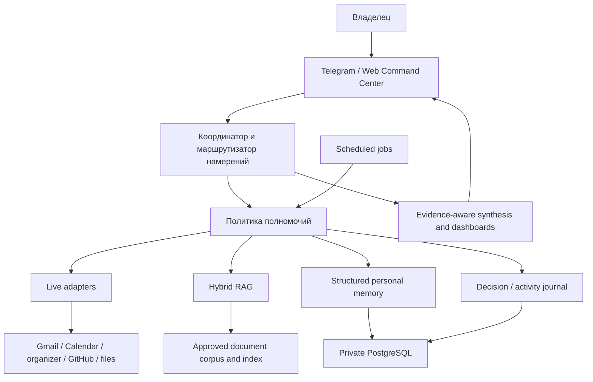

# PAIM V3 — архитектурная концепция и безопасность
Статус: DRAFT | 2026-11-25. Не техническое ТЗ, не подтвержденная совместимость конкретных версий.
## 1. Логическая схема

Путь запроса: intent + период → определить SoT/нужные данные → проверить полномочия → параллельно читать только необходимое → объединить по stable refs, не по совпадению названий → разделить факты/выводы → вернуть брифинг с evidence, freshness, coverage → при необходимости предложить действие → подтвержденный результат записать в журнал. Для простого чтения не нужны многоагентные дискуссии.
## 2. Роли и Skills
| Роль | Инструменты | Результат |
|---|---|---|
| Coordinator | source map, routing, read context | план запроса и синтез |
| Secretary | Gmail/Calendar/tasks read | день, обязательства, брифинг |
| Project analyst | GitHub/tasks/RAG | состояние проекта, ближайшие решения |
| Researcher | утвержденные web/RSS темы | датированный дайджест, источники |
| Knowledge manager | corpus ingest/retrieval | индекс, версии, поиск |
| Advisor | goals/priority/capacity, evidence | альтернативы, последствия |
| Reflection analyst | journal/history/RAG | факты деятельности, гипотезы уроков |
Memory curator — общий Skill подтверждения/корректировки памяти. P0 один координатор с Skills, typed tool contracts, ограниченные роли; отдельные агенты и модели только если измеренный выигрыш оправдывает задержку/стоимость. Codex — разработчик, не обязательный runtime. 
## 3. Build vs reuse
Reuse: готовый органайзер (выбор предстоит), Google Calendar, Gmail, GitHub, разрешенные файловые ресурсы, Telegram, LLM, существующие коннекторы/MCP/планировщик, OpenClaw при проверке возможностей. Build минимально: информационная карта/политика, слой унификации ссылок и свежести, structured memory, retrieval/configuration, шаблоны брифингов, журнал и компактный UI, только если готовое средство не покрывает. Не писать API-адаптер, если имеющийся безопасный коннектор обеспечивает нужный контракт. 
Кандидат A: OpenClaw coordinator + Skills + existing tools + Postgres/pgvector + thin dashboard. B: готовая ассистентская/knowledge platform + свои минимальные адаптеры. C: небольшой собственный orchestration service + ограниченные adapters, если A/B не проходят безопасность/управляемость. Сравнить фактические возможности, лицензии, export, privacy, cost, latency, API, RAG citations, permissions. Не подтверждать доступность продукта по одному маркетинговому описанию. Не выбирать заранее LangChain/LlamaIndex или отдельную vector DB без потребности.
## 4. Хранилища
SoT внешних сущностей остается у провайдера. Private PostgreSQL: sources, object_refs, relations, memory_items, goals/interests if PAIM-owned, decisions, activity_events, dashboard_configs, subscription_rules, jobs, approvals, audit, cache metadata, document_versions/chunks/vectors if selected. Никакого полного дублирования task/event CRUD. Индекс производный, версии с provenance, только разрешенный корпус. Отдельная БД/роль и namespace на VPS; не изменять существующие сервисы. Экспорт памяти и журнала в JSON/MD, ссылки на originals; индекс можно восстановить. Политики retention и backup подлежат отдельному согласованию. 
## 5. Полномочия (не путать с уровнями зрелости)
A0 read-only по allowlist; A1 рекомендации/черновики; A2 отдельное подтверждение точного внешнего действия (позднее); A3 заранее разрешенные обратимые внутренние операции и собственные уведомления по подписке; A4 широкая автономность исключена. P0 read-only внешние источники + подтвержденные внутренние записи + согласованные уведомления. Даже одобрение концепции не означает разрешение на подключение реальных аккаунтов.
OAuth минимальные scopes, server-side owner allowlist, separate service credentials encrypted, no tokens/personal data in public GitHub. RAG filters before retrieval, check revocation at use; stale/unknown permission fail closed. Untrusted emails/docs/web are data, never executable instructions. No model shell, direct DB, arbitrary network or secret access; tools typed allowlist, backend validation. Personal data sent to external LLM only within explicit privacy policy; choose local/remote based on sensitivity. No scraping accounts or assumed access to chat history. For Telegram owner/private chat, no full sensitive text by default. Audit source access, confirmed memory changes, approvals, external attempts and delivery status with redaction.
## 6. Надежность
Each read returns status, data, source_ref, version, observed_at, coverage. Timeouts/circuit breaker per provider, parallel reads bounded. On unavailable sources show partial dashboard; cached facts never presented as current without freshness. LLM outage -> deterministic basic fact list and direct links. Notifications dedup by subscription/event/period; quiet hours, capped frequency. For future writes reuse v1.1 A07 design: exact payload confirmation, version/ETag, durable operation ID and dispatch marker, fencing, reconcile unknown effects, no blind retry; no guarantee exactly-once external delivery. Restore test + purge manifest, deleted/revoked materials excluded from RAG and caches. 
## 7. Evaluation gates
End-to-end read-only prototype with synthetic/authorized data first. Verify source citations, authority, partial results, memory conflict and deletion, injection, permission revoke, stale live facts, cost and response time. Only after pilot decide whether web dashboard needs own front-end and whether write integration is worth risk. 
