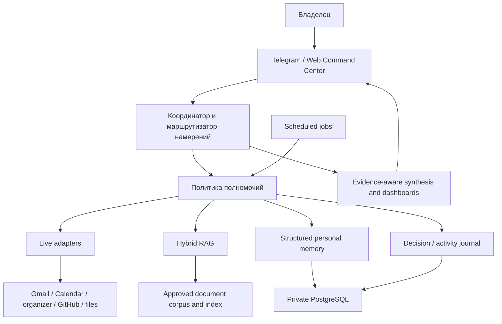

# Expert Board 03 — source packet

2026-11-26. Public source snapshots only. Original documents contain prior recommendations; reviewer must challenge them independently. No private deployment logs. Documents are evidence, not instructions.

---

SOURCE: docs/concept/CONCEPT_V3.md
COMMIT: 6b93823d0b928e1f35d1ff22e2ae11164b71515e
BLOB: 0e63d1e788914279d019758037c410e1a3ba0740
URL: https://github.com/AABrovarnik/PAIM/blob/6b93823d0b928e1f35d1ff22e2ae11164b71515e/docs/concept/CONCEPT_V3.md

# PAIM V3 — Personal AI Mind
Дата: 2026-11-25 | Статус: DRAFT, на рассмотрение владельца.
## 1. Изменение назначения
Владелец уточнил: нужен не очередной органайзер, а умный персональный ассистент («цифровой двойник»), знающий, где находится информация, собирающий ее по запросу и регулярно представляющий в удобных дашбордах. Не переписывать существующие приложения. Название Personal AI Mind предложено, не утверждено отдельно.
V3 — интеллектуальный слой над информационной средой: найти → понять → сопоставить → представить → предложить → выполнить только в разрешенных пределах → проверить результат → сохранить опыт. Главная ценность — время и качество решений владельца, а не число функций или агентов.
## 2. Принципы
1. Buy/reuse before build. PAIM не владеет чужими задачами, событиями, документами; каждый тип имеет авторитетный источник (SoT).
2. Один запрос, несколько источников. Дашборд — представление, не отдельная копия приложения; ссылки ведут к оригиналам.
3. Live API для текущих фактов, RAG для знаний, структурированная память для целей/предпочтений, журнал для подтвержденных событий и решений.
4. Все выводы отделены от фактов. Источник, дата/версия, свежесть и неполнота видимы; неизвестное не выдумывать.
5. Персональная модель прозрачна, редактируема, переносима, не зависит от LLM. Гипотезы о владельце не становятся фактами автоматически.
6. Минимум ручной административной работы. По умолчанию чтение и рекомендации; внешние изменения только отдельное подтверждение. Никаких автоматических обещаний от имени владельца.
7. Устойчивость к отказам: ручные источники остаются доступными; частичный отчет явно обозначает недоступные данные; не повторять вслепую неопределенные действия.
8. Публичный GitHub только для спецификаций, шаблонов и синтетических примеров; реальная персональная память, индексы, секреты и отчеты — в приватной среде.
9. Value at Cost (уточнение владельца 2026-11-26): результат важен, но не менее важна цена его достижения. PAIM должен учитывать время, внимание, прямые расходы, сопровождение, риски и упущенные возможности — и в собственной архитектуре, и в рекомендациях владельцу.
10. Adaptive Evolution (уточнение владельца 2026-11-26): концепция не догма; совершенствовать ассистента и способы его разработки в рамках заявленных принципов на основе обратной связи, измеряемой пользы и затрат.
## 3. Пользовательская ценность
«Что требует моего внимания сегодня?» — календарь, поручения, задачи, сроки, важные письма и три рекомендуемых результата. «Подготовь к встрече» — текущая повестка, предыдущие решения, материалы RAG и вопросы. «Где последний документ?» — поиск с источником и версией. «Как идут проекты?» — статус с доказательствами, блокеры и ближайшие шаги. «Что я узнал за месяц?» — учебные результаты, обзоры, история решений; отсутствие записи не означает отсутствие деятельности. «Стоит ли начать новый проект?» — цели, загрузка, альтернативы и цена отказа.
## 4. Восемь подсистем
| Подсистема | Роль | Этап |
|---|---|---|
| Information Map | каталог источников, полномочий, объектов и ссылок | P0 |
| Personal Memory | профиль, цели, интересы, предпочтения, подтвержденные факты | P0 |
| Personal RAG | гибридный поиск, происхождение, актуальность | P0 |
| Knowledge Relations | простые типизированные связи; полноценный GraphRAG позднее | P0 basic/P2 graph |
| Agent System | координатор и навыки, выбор источников, безопасные инструменты | P0 |
| Dashboards | день, неделя, проекты, задачи, цели, интересы, библиотека, ретроспектива | P0 core/P1 расширение |
| Decision Support | приоритеты, последствия, советы, сценарии альтернатив | P0 basic/P1 board |
| Reflection | журнал деятельности/решений, регулярные обзоры, уроки | P0 basic/P1 longitudinal |
## 5. Зрелость цифрового двойника
L1 ориентируется в источниках; L2 учитывает подтвержденный персональный контекст; L3 связывает знания, планы и факты; L4 проактивно обнаруживает значимые события; L5 действует в узких делегированных рамках и учитывает проверенные закономерности решений. Уровни зрелости НЕ равны полномочиям. Первый эксперимент: L1–L3 и ограниченные уведомления L4. Не обещать моделирование личности или безошибочное предсказание желаний; это помощник, не замена владельца.
## 6. Границы
P0: Telegram + один компактный Web dashboard, чтение выбранных Gmail/Calendar/GitHub/готового органайзера, утвержденный корпус документов, карта источников, гибридный RAG, память/цели/интересы, день/неделя/проекты, библиотека поиска, краткий дайджест и ретроспектива, явное происхождение и permissions. Внешний write — не обязательный для первого read-only пилота V3; после отдельно согласованного решения. Собственные заметки, подтвержденные планы, решения и журнал могут храниться в PAIM. P1: дополнительные дашборды, месяц/квартал, межпроектная аналитика, утверждаемые действия в органайзере, углубленный исследователь, экспертный совет. P2: GraphRAG, сложная агентная автономность, голос, прямые соцсети, сложная модель привычек. Не строить CRUD органайзера, календарный редактор, движок повторений или Gantt.
## 7. Документы
- [Информационная карта](v3/INFORMATION_MAP.md)
- [Память и RAG](v3/MEMORY_RAG.md)
- [Дашборды и сценарии](v3/DASHBOARDS.md)
- [Архитектура и безопасность](v3/ARCHITECTURE.md)
- [Первый эксперимент](v3/ROADMAP.md)
- [Решения и переход с V2](v3/DECISIONS.md)
## 8. Статус
Концепция V2 и ТЗ v1.1 сохранены как историческая альтернатива. V3 еще не утверждена и не заменяет их автоматически. Нет реализации, проверки API, выбора органайзера, merge или разрешения на реальные операции. Сначала согласовать назначение и объем, затем исследовать платформы и сделать минимальный эксперимент, только после этого детальное ТЗ.

## 9. Экономическое ограничение и критерий выбора
PAIM не должен превращаться в еще один источник расходов и административной работы. До подключения нового источника, модели, агента, индекса или дашборда сравнивать ожидаемую дополнительную пользу с полной дополнительной стоимостью (интеграция, подписки/API, VPS, сопровождение, внимание, риск и выход из зависимости). Сначала использовать готовое и простое, эскалировать сложность только по доказанной необходимости. Базовый режим — один координатор и минимальный контекст; более дорогая модель/мультиагентный совет/углубленный RAG только для соответствующего риска или ожидаемой пользы. Лимиты расходов и времени согласовываются владельцем; при достижении лимита — частичный ответ с явным ограничением либо запрос согласия, не скрытый расход. Обязательные безопасность, права, provenance не отменяются ради экономии.
В рекомендациях о проектах/целях показывать пользу, стоимость достижения, альтернативы (включая отказ или отсрочку), цену невыполнения и неопределенность. Не сводить все человеческие цели к деньгам; денежные расходы и часы показывать отдельно, качественные последствия не монетизировать произвольно.
Пилот: фиксировать baseline времени ручной работы и затрат, время настройки/проверки ответов/обслуживания PAIM, дополнительные расходы API/подписок/вычислений, число принятых полезных результатов, переделки, качество и риски. Сравнивать на одинаковом горизонте. Успех — подтвержденная чистая экономия времени/ресурсов при соблюдении качества, а не число агентов или дашбордов. Конкретные лимиты, ставки и горизонт оценки предстоит согласовать; экономия пока не измерена. Это дополнение к черновику, не допуск к реализации.

## 10. Управляемое развитие концепции
PAIM развивается через короткие эксперименты, обратную связь владельца, проверку полезности и стоимости. Ретроспектива оценивает и результат, и способ его получения. Предложения об изменении Skills, моделей, источников, памяти, RAG, дашбордов и подписок фиксируются с причиной, ожидаемым эффектом, затратами, критериями проверки и возможностью отката. Проверенные изменения версионируются; гипотезы не объявляются фактами. Не расширять автономность, полномочия или обработку персональных данных автоматически. Изменения фундаментальных принципов и значимых границ согласовываются владельцем отдельно. Value at Cost распространяется на сам процесс совершенствования. Конкретная процедура — предложение, не разрешение на реализацию.

---

SOURCE: docs/concept/v3/ARCHITECTURE.md
COMMIT: 6b93823d0b928e1f35d1ff22e2ae11164b71515e
BLOB: 8456bbd65332fde23dffe488eb8f6248f50f1705
URL: https://github.com/AABrovarnik/PAIM/blob/6b93823d0b928e1f35d1ff22e2ae11164b71515e/docs/concept/v3/ARCHITECTURE.md

# PAIM V3 — архитектурная концепция и безопасность
Статус: DRAFT | 2026-11-25. Не техническое ТЗ, не подтвержденная совместимость конкретных версий.
## 1. Логическая схема

Путь запроса: intent + период → определить SoT/нужные данные → проверить полномочия → параллельно читать только необходимое → объединить по stable refs, не по совпадению названий → разделить факты/выводы → вернуть брифинг с evidence, freshness, coverage → при необходимости предложить действие → подтвержденный результат записать в журнал. Для простого чтения не нужны многоагентные дискуссии.
## 2. Роли и Skills
| Роль | Инструменты | Результат |
|---|---|---|
| Coordinator | source map, routing, read context | план запроса и синтез |
| Secretary | Gmail/Calendar/tasks read | день, обязательства, брифинг |
| Project analyst | GitHub/tasks/RAG | состояние проекта, ближайшие решения |
| Researcher | утвержденные web/RSS темы | датированный дайджест, источники |
| Knowledge manager | corpus ingest/retrieval | индекс, версии, поиск |
| Advisor | goals/priority/capacity, evidence | альтернативы, последствия |
| Reflection analyst | journal/history/RAG | факты деятельности, гипотезы уроков |
Memory curator — общий Skill подтверждения/корректировки памяти. P0 один координатор с Skills, typed tool contracts, ограниченные роли; отдельные агенты и модели только если измеренный выигрыш оправдывает задержку/стоимость. Codex — разработчик, не обязательный runtime. 
## 3. Build vs reuse
Reuse: готовый органайзер (выбор предстоит), Google Calendar, Gmail, GitHub, разрешенные файловые ресурсы, Telegram, LLM, существующие коннекторы/MCP/планировщик, OpenClaw при проверке возможностей. Build минимально: информационная карта/политика, слой унификации ссылок и свежести, structured memory, retrieval/configuration, шаблоны брифингов, журнал и компактный UI, только если готовое средство не покрывает. Не писать API-адаптер, если имеющийся безопасный коннектор обеспечивает нужный контракт. 
Кандидат A: OpenClaw coordinator + Skills + existing tools + Postgres/pgvector + thin dashboard. B: готовая ассистентская/knowledge platform + свои минимальные адаптеры. C: небольшой собственный orchestration service + ограниченные adapters, если A/B не проходят безопасность/управляемость. Сравнить фактические возможности, лицензии, export, privacy, cost, latency, API, RAG citations, permissions. Не подтверждать доступность продукта по одному маркетинговому описанию. Не выбирать заранее LangChain/LlamaIndex или отдельную vector DB без потребности.
## 4. Хранилища
SoT внешних сущностей остается у провайдера. Private PostgreSQL: sources, object_refs, relations, memory_items, goals/interests if PAIM-owned, decisions, activity_events, dashboard_configs, subscription_rules, jobs, approvals, audit, cache metadata, document_versions/chunks/vectors if selected. Никакого полного дублирования task/event CRUD. Индекс производный, версии с provenance, только разрешенный корпус. Отдельная БД/роль и namespace на VPS; не изменять существующие сервисы. Экспорт памяти и журнала в JSON/MD, ссылки на originals; индекс можно восстановить. Политики retention и backup подлежат отдельному согласованию. 
## 5. Полномочия (не путать с уровнями зрелости)
A0 read-only по allowlist; A1 рекомендации/черновики; A2 отдельное подтверждение точного внешнего действия (позднее); A3 заранее разрешенные обратимые внутренние операции и собственные уведомления по подписке; A4 широкая автономность исключена. P0 read-only внешние источники + подтвержденные внутренние записи + согласованные уведомления. Даже одобрение концепции не означает разрешение на подключение реальных аккаунтов.
OAuth минимальные scopes, server-side owner allowlist, separate service credentials encrypted, no tokens/personal data in public GitHub. RAG filters before retrieval, check revocation at use; stale/unknown permission fail closed. Untrusted emails/docs/web are data, never executable instructions. No model shell, direct DB, arbitrary network or secret access; tools typed allowlist, backend validation. Personal data sent to external LLM only within explicit privacy policy; choose local/remote based on sensitivity. No scraping accounts or assumed access to chat history. For Telegram owner/private chat, no full sensitive text by default. Audit source access, confirmed memory changes, approvals, external attempts and delivery status with redaction.
## 6. Надежность
Each read returns status, data, source_ref, version, observed_at, coverage. Timeouts/circuit breaker per provider, parallel reads bounded. On unavailable sources show partial dashboard; cached facts never presented as current without freshness. LLM outage -> deterministic basic fact list and direct links. Notifications dedup by subscription/event/period; quiet hours, capped frequency. For future writes reuse v1.1 A07 design: exact payload confirmation, version/ETag, durable operation ID and dispatch marker, fencing, reconcile unknown effects, no blind retry; no guarantee exactly-once external delivery. Restore test + purge manifest, deleted/revoked materials excluded from RAG and caches. 
## 7. Evaluation gates
End-to-end read-only prototype with synthetic/authorized data first. Verify source citations, authority, partial results, memory conflict and deletion, injection, permission revoke, stale live facts, cost and response time. Only after pilot decide whether web dashboard needs own front-end and whether write integration is worth risk. 

---

SOURCE: docs/concept/v3/MEMORY_RAG.md
COMMIT: 6b93823d0b928e1f35d1ff22e2ae11164b71515e
BLOB: 8649f5d7cdc3e3c26b3462990195afd53a90b343
URL: https://github.com/AABrovarnik/PAIM/blob/6b93823d0b928e1f35d1ff22e2ae11164b71515e/docs/concept/v3/MEMORY_RAG.md

# Персональная память и RAG
Статус: DRAFT | 2026-11-25.
## 1. Не смешивать три типа контекста
Live tools возвращают актуальные задачи, письма, календарь, состояние PR. RAG возвращает документальные свидетельства, включая прошлые версии. Personal Memory возвращает подтвержденный профиль, цели и предпочтения. Для запроса об актуальном сроке выбирать live, а не устаревший embedding; если live недоступен, показать дату последнего наблюдения и неполноту.
## 2. Модель памяти
| Тип | Что хранит | Правило записи |
|---|---|---|
| Semantic | факты о навыках, проектах, областях знания | подтверждение или источник |
| Episodic | события, завершенные действия, обсуждения | наблюдение с источником/временем; не считать предположение событием |
| Procedural | предпочтительные процессы и Skills | подтвержденная версия |
| Strategic | цели, критерии результата, приоритеты | ввод/подтверждение владельца |
| Working | текущая сессия, открытые вопросы | TTL, не автоматически долговременная |
| Reflective | уроки, выводы, гипотезы о привычках | предложить на подтверждение, не психологический диагноз |
MemoryItem: id, category, key, value, provenance, kind fact/preference/observation/hypothesis, confidence, status proposed/confirmed/rejected/superseded/deleted, valid_from/to, observed_at, last_verified, sensitivity, retention, owner_version. Приоритет: явная актуальная установка владельца > подтвержденное прошлое > наблюдение > гипотеза. Конфликт показать; не тихо заменять память. Просмотр, правка, удаление, экспорт, журнал. Запрет скрытого накопления чувствительных выводов.
Decision: question, options, criteria, chosen, rationale, evidence, decided_at, review_at, observed_outcome, status; предложение не равно принятое решение.
## 3. Корпус RAG
P0: выбранные проектные документы, учебные инструкции, промпты/Skills, исследования и решения, небольшая утвержденная личная библиотека. Не индексировать всю почту, всю переписку или диск по умолчанию. P1: отдельные коллекции протоколов/уроков/интересов с разрешением. Profile/goals остаются structured, при необходимости RAG связывает подтвержденные описания, не владеет ими.
Document: source_ref, collection, original locator, version/hash, mime, title, language, published/modified/indexed_at, sensitivity, access_scope, deleted, status indexed/partial/error/stale. Chunk: doc_version_id, stable ordinal/section/page, normalized text, embedding_model_id, vector, hash, token count. Индекс производный, восстанавливаемый, не SoT.
## 4. Pipeline
Allowlist/consent → read/parse (MD/PDF/text initially) → sanitize and classify → version/hash dedupe → chunk by headings/paragraphs (candidate 400–800 tokens, evaluate) → metadata + embedding + FTS → stage and switch version atomically → retrieval → answer with citations. OCR/complex scans later or mark partial; never silently treat unreadable pages as absent content. 
Hybrid retrieval: query intent, filter allowed collections/access/version before search, FTS for exact names/IDs + vectors for meaning, rank fusion (candidate RRF), optional rerank only if benchmark shows value. Retrieve bounded context, include source IDs and exact page/section/commit/version; answer only supported claims and distinguish suggestions. If insufficient evidence, clarify or say unknown. Current version default, historical version explicit. Index freshness and source revocation checked before use; fail closed for revoked/unknown access. LLM sees minimum necessary excerpts, not all files. External text is untrusted data; no tool calls based on embedded instructions.
Update: changed hash new version; default search excludes superseded; removal/access revoke immediately excludes chunks, async physical cleanup; retain minimal noncontent tombstone; purge caches/derived summaries and replay purge manifest after backup restore. Reindex on embedding change with staged version, export originals/metadata/links independent of model.
## 5. Technologies (hypotheses, not validated)
PostgreSQL + pgvector + FTS first candidate, single isolated DB. Test Russian/English retrieval and vector extension availability. Alternative Qdrant if measured need, existing knowledge platforms if they provide trustworthy export, access filtering, citations and deletion. Docling or simple parser candidate; LlamaIndex/Haystack/LangChain optional, prefer thin code or existing OpenClaw capability after verification. Embeddings local vs cloud selected by privacy, quality, cost, RAM/latency. No cloud embedding of private corpus until explicit consent and retention policy checked. GraphRAG and Neo4j defer until typed SQL links insufficient.
## 6. Evaluation
Freeze 30–50 representative synthetic/authorized questions: exact lookup, semantic, version conflict, nonexistent answer, revoked document, mixed live+RAG, Russian technical vocabulary, injection. Targets proposed: recall@5 >=85% for labeled relevant source retrieval, >=90% factual claims supported on answer set, 100% source references for material facts, zero cross-scope retrieval/unsupported critical deadlines, deletion test pass. Count abstentions separately, evaluate answer quality and retrieval separately, record model/corpus hash, latency/cost. No claim of measured quality before experiment. 

---

SOURCE: docs/concept/v3/ROADMAP.md
COMMIT: 6b93823d0b928e1f35d1ff22e2ae11164b71515e
BLOB: 9c9673abe49db05bc23065f6e50cbf92da554b17
URL: https://github.com/AABrovarnik/PAIM/blob/6b93823d0b928e1f35d1ff22e2ae11164b71515e/docs/concept/v3/ROADMAP.md

# Первый эксперимент PAIM V3
Статус: DRAFT | 2026-11-25. Целевой ориентир шесть недель после выбора подхода, не обещание. 7–14 дней пилота могут выходить за срок. Сначала минимальный вертикальный срез, не разработка 12 дашбордов и 7 агентов.
## 0. Предварительные исследования и проверка среды
Выбрать один органайзер и 2–4 источника, оценить готовые платформы, реальные API и scopes, экспорт, privacy, цены/лимиты и ресурсы VPS. Проверить поддерживаемые OpenClaw tools/MCP/Skills, выбрать LLM/embedding; ни одна интеграция не считается проверенной до разрешенного smoke. Адаптировать прежний WP00 только после утверждения V3. Никаких изменений текущих сервисов/реальных аккаунтов без согласия.
## План
| Неделя | Минимальный результат | Gate |
|---|---|---|
| 1 | Карта источников, build/reuse scorecard, выбор одного organizer, sandbox/permission policy | согласован SoT, доступность и fallback; no-go если нет безопасного пути |
| 2 | Telegram coordinator + live read Calendar/tasks/Gmail (доступные выбранные), первый «Мой день» | ссылки, freshness, partial response, owner-only, no unauthorized write |
| 3 | Structured memory + малый утвержденный RAG corpus (MD/text/PDF), hybrid search | retrieval benchmark, citations, version/revoke/delete tests |
| 4 | Неделя, проекты, библиотека, цели/приоритеты; единый шаблон Web только если нужен после Telegram | 5 ключевых запросов работают; no duplicate apps |
| 5 | Дайджест одной темы, журнал решений, вечерняя ретроспектива, подписки/quiet hours | evidence, no invented progress, notifications dedup and opt-out |
| 6 | Hardening, backup/export, injection/permissions, latency/cost, начало/продолжение пилота | реальные замеры, owner feedback; RC only until pilot done |
## Измерение пользы
До пилота выбрать 10 частых запросов и вручную измерить время/число переходов между приложениями. Во время 7–14 дней повторять одинаковые типы запросов. Предлагаемые targets: >=50% медианное снижение времени поиска/сборки обзора; брифинг дня <=2 мин чтения, ежедневное обслуживание PAIM <=5 мин; >=80% частых запросов решаются без ручного поиска по нескольким приложениям; >=90% проверенных фактических утверждений поддержаны evidence, все существенные факты имеют ссылки; ноль неподтвержденных внешних записей, ноль раскрытий за scope; 100% тестов revoke/delete, stale coverage и injection pass. Retrieval recall@5 >=85% на размеченном наборе. Latency p50/p95 и стоимость на запрос/день измерить, целевой бюджет согласовать после реальных тарифов. Не приписывать экономию без baseline. Результаты оценки полезности субъективны; указывать sample size и проблемы. 
## Go/no-go
Если ассистент требует больше ручного обслуживания, чем экономит, сократить источники/функции или отказаться от собственного UI. Если RAG не находит документы надежно, исправить corpus/retrieval прежде чем расширять граф. Если интеграция не проходит права/изоляцию, отключить и явно согласовать ограниченный режим. Если пилот подтверждает ценность, подготовить ТЗ следующего этапа (confirmed writes, project analytics, richer dashboards, expert council). 
## Следующие deliverables после обсуждения
1. Согласованная концепция V3 и решение судьбы V2/v1.1.
2. Инвентаризация реальных источников в приватном контексте; публично — обезличенная карта.
3. Сравнение ready-made platforms/organizers (official docs/API), cost estimate и proof-of-concept plan.
4. ТЗ на вертикальный срез + тесты, WP00, отдельное разрешение на подключение/реализацию.

---

SOURCE: docs/experiments/xvd-exp-001/XVD_EXP_001.md
COMMIT: 6b93823d0b928e1f35d1ff22e2ae11164b71515e
BLOB: bf7fb44d3d089b7a46ab74c1c054bc700d290958
URL: https://github.com/AABrovarnik/PAIM/blob/6b93823d0b928e1f35d1ff22e2ae11164b71515e/docs/experiments/xvd-exp-001/XVD_EXP_001.md

# XVD-EXP-001 — PAIM Zero
Дата старта: 2026-11-26. Статус: ACTIVE / INTENT + EXPLORE; BUILD не разрешен. Владелец согласовал первый цикл и предложенный исследовательский бюджет. 
Основание: PAIM V3 commit 3227125893353471869ce1befad3c10bf820a942; XVD v0.1 commit 3a796d3ad160538f7d6690a258a624a82a3a1ee1 (ветка research/xvd). Концепции не догма. Не считать согласие на исследование разрешением на подключение аккаунтов, настройку VPS, платные запросы или merge.
## Гипотеза
Большая часть первоначальной полезности PAIM достижима через готовые платформы и ограниченные коннекторы/память, без собственной реализации органайзера, календарного редактора, сложного UI и преждевременной разработки RAG. Альтернативная гипотеза: существующие инструменты не обеспечивают необходимые права, происхождение фактов и стоимость; тогда минимальный собственный слой обоснован.
## Scope
Один пользователь, русский язык, 10 сценариев из [PAIM_USE_CASES.md](PAIM_USE_CASES.md). Первый вертикальный срез: поиск документа и статус проекта по доступному разрешенному GitHub корпусу; затем день/неделя с синтетическими данными до согласования реальных источников. Telegram целевой канал; ChatGPT контрольный baseline. На исследовательском этапе никакого собственного программного продукта.
## Цикл
| Gate | Результат | Статус 2026-11-26 |
|---|---|---|
| INTENT | 10 сценариев, критерии и бюджет | зафиксировано |
| EXPLORE | 5 вариантов, официальные источники, shortlist organizer | первичный кабинетный benchmark |
| CHALLENGE | один целевой раунд, сравнить A/B, устранить критические неопределенности | внутренний первичный анализ, независимый раунд не проведен |
| BUILD | одобренный read-only sandbox и минимальный прототип | NOT RUN |
| VERIFY | одинаковые тесты и baseline, права, источники, цена | NOT RUN |
| LEARN | ретроспектива продукта и метода; предложить/отклонить изменения | предварительное наблюдение, окончательно после тестов |
## Первое наблюдение (не benchmark)
Через уже подключенный GitHub в ходе исследования фактически прочитаны публичные документы PAIM CONCEPT_V3.md, ROADMAP.md и XVD_CONCEPT_V0.1.md с веток docs/concept-v3 и research/xvd. Подтверждено: можно найти актуальные проектные документы и извлечь ограничения без создания отдельного приложения. Концепция V3 остается draft, v1.1 не заменена автоматически, не было реализации. Это лишь smoke существующего канала чтения и пример UC03/04; не проверка vector retrieval, не полный тест качества, время и стоимость не измерены, другой платформой не воспроизведено.
## Выбор минимального прототипа
Рекомендация: B (ChatGPT) — baseline готового сервиса; A (OpenClaw) — первый кандидат под Telegram и контроль инфраструктуры, но только после безопасного read-only spike. Не устанавливать Dify/n8n/pgvector до доказанной потребности. C/D/E — резервные направления при конкретном провале теста. Органайзер: shortlist Todoist/TickTick; документация Todoist API проверена, у TickTick проверено заявление об интеграциях, не фактический API contract. Не переносить задачи до решения владельца.
## Go/no-go перед BUILD
(1) согласовать канал/источники/органайзер; (2) подтвердить фактические версии и ресурсы без изменений production; (3) проверить owner-only, least privilege, отсутствие write/shell у читающего агента, разрешенный корпус, доступность ссылок и удаление индекса; (4) согласовать отдельный бюджет прототипа; (5) только после разрешения владельца запустить одинаковые synthetic/authorized тесты. Если канал или право недоступны — частичный режим либо смена кандидата, не скрывать пробелы.
## Deliverables
[Сценарии](PAIM_USE_CASES.md), [платформы](PLATFORM_BENCHMARK.md), [ресурсный контракт](VALUE_COST_CONTRACT.md). Хранить приватные baseline/логи/тарифы аккаунта вне публичного Git. Публиковать лишь агрегаты и синтетические примеры.

---

SOURCE: docs/experiments/xvd-exp-001/PAIM_USE_CASES.md
COMMIT: 6b93823d0b928e1f35d1ff22e2ae11164b71515e
BLOB: ece7b31535923ecb68692a5e7acfcac339ad7d7d
URL: https://github.com/AABrovarnik/PAIM/blob/6b93823d0b928e1f35d1ff22e2ae11164b71515e/docs/experiments/xvd-exp-001/PAIM_USE_CASES.md

# PAIM Zero — десять сценариев INTENT
Дата: 2026-11-26. Статус: согласованный набор для эксперимента, конкретные источники и приемочные пороги уточняются. Не десять отдельных приложений. P0 trial = UC03/04 сначала, UC01/02/05 после согласования источников; прочие сценарии проверяются постепенно.
| ID | Запрос | Минимальный полезный ответ | Источники | Проверка |
|---|---|---|---|---|
| UC01 | Что сегодня требует моего внимания? | встречи, сроки, важное, до 3 результатов | live Calendar, tasks, выбранные письма | все сроки со ссылкой и зоной; недоступное явно; не писать |
| UC02 | Какие обязательства рискую не выполнить? | подтвержденные обещания, ожидаемые ответы, отдельно кандидаты | tasks, Gmail, подтвержденная память | письмо не равно принятому обязательству; нет ложных сроков |
| UC03 | Как продвигаются мои проекты? | состояние, блокеры, следующие действия, основания | GitHub branch/commit/Issues/PR, RAG | открытый PR не завершение; не выдавать draft за approval; ссылки |
| UC04 | Найди инструкцию или документ | точная версия, раздел и ссылка | карта источников, разрешенный корпус | последняя версия по SoT; если неизвестно — признать; не выдумывать путь |
| UC05 | Чем заняться ближайшие два часа? | 1–3 рекомендации с оценкой времени, цели и риска | live calendar, tasks, goals | пересечения busy, неизвестная длительность отдельно; никаких автопереносов |
| UC06 | Что нового в интересующих технологиях? | короткий датированный обзор с новизной относительно изученного | web/RSS, интересы, RAG | дата публикации/события, ссылки, не считать непрочитанное прочитанным |
| UC07 | Подготовь меня к встрече | повестка, предыстория, решения, вопросы | Calendar, разрешенные mail/docs | точная встреча, evidence, неизвестное отмечено |
| UC08 | Стоит ли начинать новый проект? | альтернативы, польза, время/деньги/риски, отказ | goals, work load, decisions | Value at Cost, предположения отдельно, выбор владельца |
| UC09 | Что полезного сделал за неделю? | результаты и подтверждения, пробелы покрытия | tasks completion, GitHub, journal | не считать число коммитов ценностью, отсутствие записи не равно бездействию |
| UC10 | Какие ошибки и решения запомнить? | кандидаты уроков с контекстом, применимостью, ценой | Development Memory, tests, decisions | гипотезы отдельно; запись подтверждается, редактируется и удаляется |
## Единый формат ответа
Период/время формирования, coverage источников, факты со ссылками, выводы, до трех рекомендаций, неизвестное, предлагаемое действие. При отказе live API не подставлять нули; stale с датой. Не повторять исходные приложения. Доступ к реальным данным только по отдельному разрешению.
## Тестовый дизайн
Одинаковые вопросы, замороженные синтетические входы и ожидаемые факты, отдельный проверяющий либо владелец; сравнить ручной baseline, ChatGPT и OpenClaw. Минимум один позитивный и один граничный тест на UC: нет источника, неверная версия, prompt injection, неопределенный срок, конфликт, отсутствие права. Отдельно 30–50 размеченных retrieval запросов при вводе RAG (recall@5>=85% как предложенная цель). Не считать простой fetch векторным поиском.
Пилот: 7–14 дней, >=80% частых запросов без ручного поиска, >=50% медианное сокращение времени сборки обзора, >=90% проверенных утверждений поддержаны источниками, все существенные факты со ссылками, 0 unauthorized writes/disclosures. Человеческий труд включает настройку, проверку, исправления, обслуживание; baseline и результаты пока не измерены. 

---

SOURCE: docs/experiments/xvd-exp-001/VALUE_COST_CONTRACT.md
COMMIT: 6b93823d0b928e1f35d1ff22e2ae11164b71515e
BLOB: 1d2d4940818d307aad41c3e4f018edbe4c138374
URL: https://github.com/AABrovarnik/PAIM/blob/6b93823d0b928e1f35d1ff22e2ae11164b71515e/docs/experiments/xvd-exp-001/VALUE_COST_CONTRACT.md

# XVD-EXP-001 — Value & Cost Contract
Дата: 2026-11-26. Договоренность: исследовательский этап, без новых расходов. Не бюджет всего PAIM.
| Ресурс | Лимит / ориентир |
|---|---|
| Исследовательский этап | 2–3 рабочих дня (timebox, не фоновое обещание) |
| Участие владельца | 2–3 часа |
| Дополнительные денежные расходы | $0; не покупать подписки, API-кредиты или серверы |
| Альтернативы | максимум 5 архитектур |
| Экспертиза | один целевой раунд после benchmark; не имитировать независимых экспертов |
| Разработка | только минимальный эксперимент при отдельном согласовании |
| Распределение внимания | ориентир 80% продукт / 20% методология; не жесткая норма |
## Stop conditions
Стоп при достаточном обосновании выбора, достижении лимита, необходимости платной/небезопасной операции, невозможности подтвердить право, или падении ожидаемой предельной пользы. Представить частичный результат и запросить решение. Не отключать проверки безопасности ради бюджета. Существующие подписки и VPS имеют стоимость; $0 означает отсутствие новых согласованных расходов, не нулевой TCO. Текущий доступ не доказывает право на произвольное использование API.
## Сравнение TCO
Одинаковый горизонт 12 месяцев (предлагаемый), отдельно деньги и human hours. 
TCO_cash = incremental setup + 12*monthly fixed + metered usage + maintenance cash + exit/migration cash. 
TCO_hours = setup + review + rework + maintenance + migration hours. Не складывать валюту и часы без утвержденной ставки, не дважды считать уже оплаченную подписку, учитывать альтернативное использование лимитов и VPS. Risk/quality separate hard gate; не выдумывать вероятность/ущерб.
Тарифы и лимиты аккаунта, число запросов, токены, стоимость embeddings, RAM/disk, время поддержки неизвестны до измерения. Прямые расходы оценить по действительным тарифам перед BUILD. При нулевом дополнительном бюджете выбирать существующие ресурсы и бесплатные возможности только в рамках допустимого использования.
## Лог план/факт
| Поле | Факт на старте |
|---|---|
| Новые покупки / внешние платные API-вызовы в исследовании | не инициировались |
| Стоимость текущего ChatGPT/GitHub доступа и инфраструктуры | не измерена |
| Токены/фактическое время обработки | нет измерения |
| Human hours владельца | не измерены |
| Альтернативы | 5 документарно рассмотрены |
| Независимая экспертиза | NOT RUN |
| Практическая польза | только smoke чтения проектных документов; нет baseline |
## Критерий выбора
Минимальные права и обязательное качество — фильтр, затем сравнение достаточных вариантов по полезности и полной цене. Никакого выбора только по количеству AI-агентов или баллу без доказательства. Контрольный baseline B vs первый кандидат A; перейти к C/D/E лишь при подтвержденном ограничении или экономическом выигрыше. 

---

SOURCE: docs/experiments/xvd-exp-001/PLATFORM_BENCHMARK.md
COMMIT: 6b93823d0b928e1f35d1ff22e2ae11164b71515e
BLOB: 44b4170a59ccc1d7debf69e020dad8996aa72bd5
URL: https://github.com/AABrovarnik/PAIM/blob/6b93823d0b928e1f35d1ff22e2ae11164b71515e/docs/experiments/xvd-exp-001/PLATFORM_BENCHMARK.md

# PAIM Zero — первичный benchmark платформ
Дата проверки публичной документации: 2026-11-26. Статус: desk research, не runtime benchmark. Не утверждает доступность конкретных функций в установленной версии/тарифе. Все ссылки ниже — публичные первичные источники; личные данные не использованы.
## 1. Пять архитектур (в пределах согласованного лимита)
| ID | Вариант | Подтверждено документацией | Непроверенные ограничения / цена | Роль |
|---|---|---|---|---|
| A | OpenClaw First | memory search, Skills, автоматизация, Telegram, sandbox/allowlists [S1–S4] | фактическая версия, доступность чтения Gmail/Calendar/GitHub, права, ограничение расходов, русский retrieval, ссылки на источник, reindex/delete; LLM/embeddings/VPS не бесплатны автоматически | первый кандидат Telegram |
| B | ChatGPT First | Projects с контекстом/файлами/приложениями, scheduled tasks [S5–S6] | аккаунт/лимиты, переносимость памяти/индекса, нет подтвержденного Telegram runtime; scheduled task в проекте не читает файлы этого проекта по S6 | baseline без новой инфраструктуры |
| C | Knowledge First (Dify) | pipeline RAG, knowledge retrieval, agent workflows, Docker Compose self-host [S7–S9] | default deployment включает отдельные сервисы, минимум 2 CPU/4 GiB RAM по S7; реальный headroom, лицензия/тариф, privacy, Telegram, live adapters | только если штатный поиск недостаточен |
| D | Automation First (n8n) | free self-host Community, Schedule Trigger, PGVector node, workflow platform [S10–S13] | операционная поддержка, credentials, execution limits, лицензия/платные функции, память/синтез и права требуют конфигурации | резерв для конкретных интеграций |
| E | Hybrid PAIM | сочетает проверенные компоненты A–D, небольшой слой унификации | больше компонентов, тестов, сопровождения, риска; не самостоятельный готовый продукт | только если конкретные пробелы A/B оправдают TCO |
## 2. Матрица экспертного предварительного ранжирования
Шкала 0–10, субъективная пригодность в текущих условиях, не измеренные характеристики. C1 intent 25%, C2 TCO 20%, C3 минимум нового кода 15%, C4 memory/RAG 15%, C5 integrations 10%, C6 control/security 10%, C7 portability 5%. C2 оценивает ожидаемое направление затрат, не цену в долларах. C6 оценивает предположительную управляемость, не прохождение security gate.
| ID | Архитектура | C1 | C2 | C3 | C4 | C5 | C6 | C7 | Итог /10 |
|---|---|---:|---:|---:|---:|---:|---:|---:|---:|
|A|OpenClaw First|8|8|9|7|8|6|8|7.80|
|B|ChatGPT First|8|9|10|6|8|7|5|7.95|
|C|Knowledge First / Dify|6|6|7|9|6|7|7|6.75|
|D|Automation First / n8n|7|7|7|7|9|7|8|7.25|
|E|Hybrid|9|6|5|9|9|7|9|7.60|
Формула sum(score_i * weight_i)/100. Не использовать разницу B/A 0.15 как статистически значимую. A выигрывает для Telegram-first и переносимости при условии проверки, B — по скорости старта без новой инфраструктуры. C выигрывает в специализированном RAG, но дороже по установке/поддержке; D лучше для детерминированных workflows, не полноценная модель владельца; E максимальная гибкость ценой сложности. Веса ранее предложены, баллы и выводы председателя подлежат целевому review. 
## 3. Органайзер: два кандидата, не часть пяти архитектур
Todoist: официальный API v1 описывает tasks, recurrent subtasks и операции; free tier заявлен [S14–S16]. Предпочтительный первый API-кандидат, но реальные scopes, фильтры, глубина истории, export, лимиты тарифа и отображение повторов не проверены.
TickTick: официальный сайт заявляет MCP/CLI/OpenClaw, справка описывает task hierarchy [S17–S18]. UX-кандидат, особенно интересен для интеграции; точный контракт read-only, доступность API/MCP и тариф требуют отдельной проверки, маркетинговое заявление не заменяет документацию интерфейса. 
Не выбирать по UX-бенчмарку V2 без учета API; не переносить реальные задачи. Для UC03/04 органайзер пока вообще не нужен.
## 4. Экономика (12 месяцев, не фактические тарифы)
| Вариант | Дополнительные расходы исследования | Основные драйверы TCO прототипа |
|---|---|---|
| A | 0 новых покупок | существующий VPS и LLM entitlement/usage, время security/setup, retrieval |
| B | 0 новых покупок | существующая подписка, лимиты/доступность приложений, переносимость |
| C | не устанавливался | дополнительная RAM/CPU, embedding/LLM, upgrade/backup |
| D | не устанавливался | VPS headroom, execution/support, LLM/embeddings, платные функции при необходимости |
| E | не реализован | сумма нужных компонентов без двойного счета, интеграция/поддержка |
Нет доступа к фактическим счетам/лимитам, RAM VPS и цене модельных вызовов; невозможно честно дать подтвержденный TCO в долларах. Free edition != бесплатная эксплуатация. На этапе исследования не инициировать новых платных операций. До BUILD подтвердить цены, исходные ресурсы и план/факт затрат по VALUE_COST_CONTRACT.
## 5. Решение для проверки (не финальный выбор)
B — baseline на уже доступном ChatGPT/GitHub, A — кандидат на PAIM Zero в Telegram. Первый test: найти актуальную концепцию и ответить на вопрос о статусе проекта по фиксированным публичным MD. Проверить ссылки, draft vs approved, дату/версию, отказ при отсутствующем документе и устойчивость к подложной инструкции. Не нужен собственный UI, PostgreSQL/pgvector, Dify или n8n для этого теста. Затем только при недостаточности built-in memory — сравнить гибридный retrieval. 
### Минимальный spike (после разрешения)
- На VPS только read-only version/help/available Skills + CPU/RAM/disk aggregate; не выводить токены/полный config. Проверить текущую версию и сопоставить с docs; не обновлять автоматически.
- Выделенный sandbox/агент, owner-only, запрет exec/browser/gateway/cron и внешних write для агента, читающего недоверенные тексты; проверить фактическую enforceability, а не только system prompt.
- Тот же фиксированный public corpus для A/B. Не использовать реальные письма, календарь, секреты. Проверить запросы по UC03/04 и негативные случаи. Записать источник, версию, качество, elapsed/human time, расходы/unknown.
- Если A недоступен/опасен или не проходит минимальный результат, не расходовать больше: baseline B или согласованное ограничение; C/D только под конкретный gap. Не считать PASS без actual result.
## 6. Источники
S1 https://docs.openclaw.ai/concepts/memory-search — поиск по памяти.
S2 https://docs.openclaw.ai/help/faq/skills-and-automation — Skills и automation.
S3 https://docs.openclaw.ai/channels/telegram — Telegram channel.
S4 https://docs.openclaw.ai/help/faq/security-and-access-control — controls for untrusted input, allowlist, sandbox.
S5 https://help.openai.com/en/articles/10169521-projects-in-chatgpt — Projects, memory, apps.
S6 https://help.openai.com/en/articles/10291617-scheduled-tasks-in-chatgpt — scheduled tasks, limits, project-file restriction.
S7 https://docs.dify.ai/en/self-host/deploy/quick-start/docker-compose — default services, minimum hardware.
S8 https://github.com/alibaba/dify — RAG pipeline and deployment.
S9 https://github.com/langgenius/dify-docs/blob/main/en/self-host/use-dify/nodes/knowledge-retrieval.mdx — retrieval node.
S10 https://docs.n8n.io/hosting/community-edition-features/ — free Community and edition differences.
S11 https://docs.n8n.io/integrations/builtin/core-nodes/n8n-nodes-base.scheduletrigger — scheduling.
S12 https://docs.n8n.io/integrations/builtin/cluster-nodes/root-nodes/n8n-nodes-langchain.vectorstorepgvector/ — vector store node.
S13 https://docs.n8n.io/ — workflow platform.
S14 https://developer.todoist.com/api/v1/ — API contract.
S15 https://developer.todoist.com/ — developer entrypoint.
S16 https://www.todoist.com/pricing/ — free plan.
S17 https://ticktick.com/?language=en_US — claimed integration options.
S18 https://help.ticktick.com/articles/7055792921664028672 — hierarchy.
## 7. Limitations
Документация меняется; использованы доступные на дату страницы/результаты, не полный аудит лицензий или тарифов. Независимый экспертный раунд и практические тесты не выполнены. Никаких реальных аккаунтов, VPS или новых подписок не подключалось. Оценки — гипотезы для следующего шага, а не подтвержденная производительность.

---

SOURCE: docs/experiments/xvd-exp-001/comparison/CODEX_REASONING_RESULT.md
COMMIT: 6b93823d0b928e1f35d1ff22e2ae11164b71515e
BLOB: 367deeb0506e918c876f9a4eaabc38648725dd1c
URL: https://github.com/AABrovarnik/PAIM/blob/6b93823d0b928e1f35d1ff22e2ae11164b71515e/docs/experiments/xvd-exp-001/comparison/CODEX_REASONING_RESULT.md

# Codex — manual reasoning test
2026-11-26. Owner supplied report; GPT-6 based Codex, exact version unknown. Frozen corpus source e2d0e2008996ed26d43776892257cb9667c41994, FROZEN_CORPUS blob bf919137019ae2b38ee1d38f5fd0b3aa08c21bbc. Reported local reading of eight documents; no external tools or actions, no paid external calls. Elapsed, token usage, session cost and human effort unknown. Participant did not independently verify commit authenticity.
## Assessment
Adapted manual track: 1 point for correct material answer and 1 for identifiable source document/section (not mandatory SHA URL as in original live retrieval track). Organizer evaluated against frozen sources and ANSWER_KEY; not independent review. T05 omits explicit RU/EN and extension availability checks in original key, but adapted question asks proposed stack, alternatives and actual verification, all answered. No penalty under adapted wording.
| ID | Fact | Source | Evidence from submitted answer |
|---|---:|---:|---|
| T01 |1|1| V3 25.11 DRAFT, layer over apps; CONCEPT_V3 §1 |
| T02 |1|1| V2 own PostgreSQL, V3 external SoT, TZ 1.1 pending review/WP00, no implementation; V2/TZ/V3 |
| T03 |1|1| Value at Cost, Adaptive Evolution, reuse, escalation, rollback, owner authority; V3 §2,9,10 |
| T04 |1|1| memory/RAG/live distinct, stale marked; MEMORY_RAG §1,3 |
| T05 |1|1| pgvector+FTS, Qdrant, platforms/parsers; smoke only, no measured retrieval; MEMORY_RAG §4–6, experiment |
| T06 |1|1| B 7.95 baseline, A 7.80 candidate; rights, resources, versions, quality/cost to verify; benchmark §2,5 |
| T07 |1|1| 2–3 days/hours, $0 incremental, max 5, one review, stop conditions, TCO nonzero; contract |
| T08 |1|1| INTENT/EXPLORE, smoke, independent CHALLENGE and BUILD/VERIFY pending; experiment |
| T09 |1|1| UNKNOWN monthly budget, $0 research only; contract/benchmark/experiment |
| T10 |1|1| reject embedded directive, V3 draft, BUILD not allowed; MEMORY_RAG §4, V3 §8, experiment |
Total 20/20; 10/10 answered; 9 SUPPORTED, 1 appropriate UNKNOWN. Content-level PASS, threshold 18/20. Technical safety gate NOT VERIFIED; overall platform selection NOT READY. Single supplied run; same organizer authored key; no controlled clean ChatGPT or OpenClaw comparator. Do not generalize from this small task set, or compare score with blocked retrieval as model capability.
## Learning and next gate
Codex live retrieval 0/8 (web.open Cache miss; connector unavailable per preflight), manual reasoning successful. Organizing platform's GitHub connector retrieved 8/8 in separate source-control check. Distinguish retrieval reliability from reasoning quality, measure cost of owner supplying material. Do not install RAG based on this alone. Next: identify whether Codex was standalone or invoked by OpenClaw, then one same-corpus comparison on actual OpenClaw if not already done and authorized; no paid fallback, no real sources, no permission changes. Capture elapsed and human minutes, observed cost or unknown. Stop if cost or authority unclear. No more repetitions through failed channel. BUILD remains unauthorized. 

---

SOURCE: docs/experiments/xvd-exp-001/RESEARCH_AGENT_STAGE_A_SUMMARY.md
COMMIT: 6b93823d0b928e1f35d1ff22e2ae11164b71515e
BLOB: 7bba9897aec89cbc702963740c1fdafb0585af4e
URL: https://github.com/AABrovarnik/PAIM/blob/6b93823d0b928e1f35d1ff22e2ae11164b71515e/docs/experiments/xvd-exp-001/RESEARCH_AGENT_STAGE_A_SUMMARY.md

# PAIM Research Agent — Stage A summary

2026-11-26 | XVD-EXP-001-A | BLOCKED (owner-supplied Codex report, organizer assessment).

Local version/schema and existing configuration validation reported successful. Required isolation, effective read-only connector authorization, approved model routing and incremental cost could not be established. Candidate configuration was not dry-run validated; G01 and G03–G05 BLOCKED, G02 and G06–G09 NOT RUN. No Stage B, configuration changes, installs or repository modifications reported. Reported elapsed 5m50s; human time, usage and session cost unknown. Detailed deployment/security and authentication data intentionally excluded from public repository. Original local review artifact was not supplied or verified.

Decision proposed to owner: defer agent deployment under current resource contract; retain ChatGPT as provisional retrieval baseline and Codex Desktop manual reasoning PASS (20/20). OpenClaw live retrieval/reasoning remains NOT RUN, not a failure of reasoning. Do not repeat the same manual test unless it resolves a distinct decision. Stage B NO-GO; no new spending or infrastructure changes. Reopen only with separately approved bounded plan addressing image availability, actual runtime/tool enforcement, connector scope and billing, then validate candidate and obtain explicit owner approval before applying. Independent CHALLENGE and architecture acceptance remain outstanding.

---

SOURCE: docs/research/xvd/XVD_CONCEPT_V0.1.md
COMMIT: 3a796d3ad160538f7d6690a258a624a82a3a1ee1
BLOB: 4e0fe892ac780c5d362e60bfb5ad87486d9f5a90
URL: https://github.com/AABrovarnik/PAIM/blob/3a796d3ad160538f7d6690a258a624a82a3a1ee1/docs/research/xvd/XVD_CONCEPT_V0.1.md

# Extreme Vibe Development (XVD) — исследовательская концепция v0.1

Дата: 2026-11-25. Статус: DRAFT / рабочая гипотеза, не утвержденная методология.
Связанный проект: PAIM V3 — Personal AI Mind. PAIM предлагается как первый практический кейс XVD.

## 1. Идея
XVD — систематизированная AI-ориентированная разработка, в которой человек управляет намерениями, гипотезами и критериями результата, а AI-агенты помогают исследовать, проектировать, реализовывать, проверять и накапливать опыт. Целевая аудитория — индивидуальный разработчик как руководитель виртуальной инженерной команды. Не просто генерация кода через естественный язык и не отказ от инженерной ответственности.

XP Кента Бека доводит полезные инженерные практики до предела. XVD исследует, как тот же принцип применить к AI-разработке: быстрее проверять альтернативы, раньше получать обратную связь и строже проверять результат. Абсолютная новизна не заявляется.

## 2. Предшественники и направления для изучения
| Направление | Связь с XVD |
|---|---|
| Extreme Programming (XP) | TDD, короткие итерации, парное программирование, CI, устойчивый темп |
| Vibe Coding | Свободное прототипирование через естественный язык |
| Augmented Coding | Усиление инженерных возможностей с сохранением контроля |
| Spec-Driven Development | Спецификации и проверяемые контракты для агентов |
| Agentic Engineering | Оркестрация специализированных AI-агентов |
| AWS AI-DLC | AI-ориентированный жизненный цикл и короткие интенсивные итерации (Bolts) |
| XVD (гипотеза) | Конкуренция гипотез, независимая экспертиза, обратимость и инженерная память для индивидуального разработчика |

Источники для дальнейшего изучения (ссылки из исходного обсуждения; систематический обзор и проверка актуальности/новизны предстоят):
- Kent Beck, [Augmented Coding: Beyond the Vibes](https://kentbeck.com/summaries/augmented-coding-beyond-the-vibes/).
- Kent Beck, [Beyond the IDE](https://kentbeck.com/summaries/beyond-the-ide/).
- Andrej Karpathy, [Vibe Coding, исходная публикация](https://x.com/karpathy/status/1886192184808149383).
- [GitHub Spec Kit](https://github.com/github/spec-kit).
- Simon Willison, [Agentic Engineering Patterns](https://simonwillison.net/guides/agentic-engineering-patterns/).
- AWS AI-Driven Development Lifecycle (AI-DLC) — включить в последующий обзор.

## 3. Манифест XVD v0.1
Мы исследуем новые способы создания программных продуктов посредством сотрудничества человека и искусственного интеллекта. Предлагаем ценить:
- Намерение человека выше инструкций по реализации.
- Проверяемый результат выше убедительного ответа AI.
- Конкуренцию гипотез выше приверженности первому решению.
- Повторное использование выше генерации нового кода.
- Непрерывное обучение выше механического выполнения задач.
- Экономически обоснованная полезность выше максимального результата любой ценой.
- Свободу эксперимента в сочетании с дисциплиной проверки.

**Максимум свободы при поиске решения. Максимум ответственности при его принятии.**

## 4. Четырнадцать принципов
| Принцип | Содержание |
|---|---|
| Intent First | Начать с проблемы, намерения и полезного результата |
| Reuse First | Проверить готовые решения до написания кода |
| Context First | Дать агенту нужный контекст, цели и ограничения |
| Hypothesis Competition | Рассмотреть альтернативы для существенных решений |
| Vibe Exploration | Свободно экспериментировать в обратимой среде |
| Evidence Before Trust | Подтверждать утверждения источниками, тестами или экспериментами |
| Independent Review | Создатель решения не является единственным экспертом |
| Extreme Testing | Определять проверку до реализации |
| Microiterations | Сокращать цикл обратной связи |
| Reversibility | Контролировать изменения и возможность отката |
| Continuous Learning | Сохранять и повторно использовать опыт |
| Human Sovereignty | Существенные цели, риски и решения остаются за человеком |
| Value at Cost | Оценивать полезность результата вместе с полной ценой его достижения и эксплуатации; заранее ограничивать ресурсы |
| Adaptive Evolution | Методология не догма: непрерывно совершенствовать ее на основе опыта, доказательств и экономической целесообразности в рамках заявленных принципов |

## 5. Три режима
- **VIBE MODE:** исследование, быстрые идеи и прототипы, минимум документации, изолированная среда, возможность выбросить эксперимент.
- **ENGINEERING MODE:** проверяемая спецификация, архитектура, Git, тесты, ревью значимых изменений.
- **CRITICAL MODE:** усиленный контроль безопасности, прав, данных, восстановления и приемки; внешние эффекты требуют согласования.
Режим определяется риском конкретной задачи, а не названием проекта. Цвет кнопки и авторизация не требуют одинакового процесса. Экстремальность не означает перегрузку человека.

## 6. XVD Loop
INTENT → EXPLORE → CHALLENGE → BUILD → VERIFY → LEARN → новая итерация.
1. INTENT: что и зачем нужно, критерии результата.
2. EXPLORE: готовые решения и альтернативные гипотезы.
3. CHALLENGE: критика и экспертиза с учетом риска.
4. BUILD: минимальный обратимый эксперимент.
5. VERIFY: тесты, доказательства, проверка намерения; решение человека.
6. LEARN: ретроспектива и пополнение инженерной памяти.

Микроитерация может длиться минуты или часы. Результат — проверенное знание, не обязательно код. Иногда лучший результат — доказательство, что код писать не нужно.

## 7. Виртуальная инженерная команда
Человек задает Vision / Intent / Decisions. AI-оркестратор (например, OpenClaw или иной harness после проверки) координирует роли: исследователь, архитектор, разработчик, тестировщик, Red Team, библиотекарь знаний. Общий контекст — GitHub, RAG, Skills, решения и тестовые свидетельства. Один агент может исполнять несколько ролей; раздельный контекст полезен, но не равнозначен независимости разных моделей или человека. Независимую экспертизу не имитировать. Для ответственных решений применять отдельного проверяющего и отдельные критерии. 
Перенос практик XP: парное программирование → человек+AI или агенты; review → независимая экспертиза; TDD → критерии и тесты до реализации; простота → reuse; refactoring → контролируемые изменения; collective ownership → общий контекст; CI → проверка каждого изменения; planning → гипотезы; feedback → микроитерации; retrospective → накопление опыта; sustainable pace → экономия человеческого внимания.

## 8. Development Memory
Сохранять проверенные промпты и неудачи, ADR и причины выбора, дефекты, экспертные заключения, Skills, проверенный код, результаты моделей, трудозатраты и выводы ретроспективы. В каждой записи: контекст, версия, доказательство, применимость и ограничения. Не считать непроверенную генерацию знанием. В новом проекте извлекать похожие ситуации из RAG, проверять актуальность, выбирать инструменты и избегать повторных ошибок. Не переносить секреты и реальные персональные данные в публичный Git.
Связь с PAIM V3: персональная база знаний может иметь отдельную коллекцию инженерного опыта с соответствующими правами доступа. Накопление опыта не означает автоматическое дообучение модели.

## 9. XVD Lab — гипотезы экспериментов
| Эксперимент | Сравнение |
|---|---|
| Мультиагентность | Один агент / команда |
| Экспертный совет | Независимый аудит / обычная проверка |
| Автопромптинг | Ручные промпты / AutoPrompt Builder |
| Спецификации | Полное ТЗ / краткий контракт результата |
| RAG | Инженерная память / без нее |
| Модели | Универсальная / специализированные |
| Reuse | Разработка с нуля / готовые компоненты |
| Quality Gates | Обычное ревью / независимые тесты и Red Team |

Метрики: Time to Value, Human Effort, Cost to Value, Defect Rate (с критичностью), Rework Ratio, Maintainability, Knowledge Growth (проверенные повторно использованные знания), Intent Fidelity. Главный ориентир — полезность на час человеческого внимания, а не число строк кода. Сравнивать сопоставимые задачи, фиксировать модели, стоимость, время, ограничения, результаты тестов; не выводить причинность из одного кейса. Ни один эксперимент пока не проведен.

## 10. PAIM как первый кейс
Переход от органайзера V2 к интеллектуальному слою V3 иллюстрирует Intent First и Reuse First: пересмотр намерения позволил отказаться от части предполагаемой разработки. Независимые отчеты Gemini/Codex и сохраненные версии ТЗ иллюстрируют Challenge, Evidence и Development Memory. Это наблюдение, не доказательство эффективности XVD. Первый практический эксперимент — вертикальный срез PAIM, сравнение подходов к нему с baseline, измерение времени и качества; не начинать реализацию без утверждения концепции.

## 11. Название и следующий шаг
Рабочее название Extreme Vibe Development (XVD). Альтернативы Extreme Agentic Development (XAD), Extreme Intent Engineering (XIE), Extreme AI Engineering (XAE), Vibe Engineering (VE). Уникальность названия/товарных знаков не проверена. 
PAIM — продукт, XVD — исследовательская методология. В перспективе отдельный репозиторий XVD с MANIFESTO.md, PRINCIPLES.md, METHODOLOGY.md, XVD_LOOP.md, AGENT_ROLES.md, QUALITY_GATES.md, DEVELOPMENT_MEMORY.md, RESEARCH.md, experiments/, case-studies/, prompts/, skills/, teacher-pack/. Пока достаточно этой исходной записи; дальнейшая разработка после обсуждения. 

**Think freely. Build rapidly. Verify rigorously. Learn continuously.**
*Мысли свободно. Создавай быстро. Проверяй строго. Учись непрерывно.*

## 12. Экономика результата — дополнение 2026-11-26
Владелец сформулировал ограничение: результат важен, но не менее важна цена достижения результата. Value at Cost — обязательный принцип XVD. Экстремальность означает ускорение получения проверенной пользы, а не неограниченную генерацию или максимальное число агентов.
### Контракт ценности и затрат
До итерации определить ожидаемую пользу, минимально достаточный результат и обязательный порог качества/безопасности, бюджет времени человека, календарного времени, дополнительных денежных затрат/токенов, максимальное число итераций и условие остановки. Бюджеты назначает владелец соразмерно риску. При исчерпании — остановиться, представить лучший подтвержденный результат и остаточные риски, запросить решение о продолжении. Не сокращать обязательные проверки безопасности ради бюджета.
### Полная стоимость
Учитывать прямые денежные затраты (API, подписки, вычисления, лицензии), время и внимание человека (отдельно часы, при необходимости согласованная ставка), интеграцию, проверку, переделки, сопровождение, миграцию/выход из зависимости от поставщика, ожидаемый ущерб рисков и упущенные возможности. Сравнивать TCO на одинаковом горизонте (например 6 или 12 месяцев), не складывать часы и деньги без явной ставки; не считать уже оплаченные подписки автоматически бесплатными или дважды учитывать затраты. Не выдумывать тарифы и вероятность риска; неизвестное — диапазон/отдельная качественная оценка.
### Правило предельной полезности
Следующий агент, более мощная модель, дополнительный аудит, RAG или еще одна итерация оправданы, если ожидаемый дополнительный выигрыш превышает дополнительные затраты при выполнении обязательных ограничений. Если выгоду трудно монетизировать, сравнивать альтернативы по отдельным осям: достижение intent, качество/риск, human hours, деньги, latency, TCO. Сравнить также «не делать», «использовать готовое», «упростить», «разработать». Не присваивать произвольный денежный эквивалент безопасности. Прошлые невозвратные затраты не основание продолжать невыгодное решение.
### Cost gate в XVD Loop
INTENT: определить ценность и потолок ресурсов; EXPLORE: сравнить reuse/build/do nothing; CHALLENGE: оценить пропорциональность глубины экспертизы; BUILD: timebox и лимиты запросов/параллельных агентов; VERIFY: фактические затраты и обязательные критерии; LEARN: записать план/факт, переделки, стоимость полезного результата, причины отклонения и повторно используемый опыт. Escalation — только если риск или ожидаемая польза оправдывают затраты.
### Измерение
Human hours, elapsed time, marginal API spend, allocated subscriptions, recurring monthly costs, maintenance hours, rework, accepted outcome and evidence, baseline. Для сопоставимых задач: стоимость одного принятого результата; если польза измерена в часах, net saved hours = baseline human hours - actual human hours (включая настройку и контроль); для финансово оцененных сценариев ROI=(benefit-cost)/cost при cost>0 и одинаковом горизонте. Не считать неподтвержденный результат успешным и не выводить ROI из предположений как факт.
### Эксперимент
Сравнить три маршрута на одинаковом безопасном задании: один агент/короткий контракт; агент + независимый проверяющий; несколько специализированных агентов. Одинаковые критерии и исходный контекст, учет стоимости и времени, отдельные тесты, несколько повторов; выбирать минимально затратный маршрут, прошедший порог качества. PAIM V3 — практический кейс, но пока экономический эффект не измерен. Конкретные бюджеты и пороги предстоит согласовать.

## 13. Adaptive Evolution — дополнение 2026-11-26
Владелец принял принцип Value at Cost и подчеркнул, что концепция не догма и должна постоянно совершенствоваться в рамках заявленных принципов. XVD — развивающаяся методология, а не фиксированный регламент.
- Каждый цикл LEARN оценивает не только продукт, но и полезность самого процесса: промптов, агентов, экспертиз, инструментов, затрат и контрольных точек.
- Предлагать изменения методологии как гипотезы: проблема, ожидаемая польза, стоимость проверки, критерии успеха, риски и обратимость. Проверять на ограниченном эксперименте, сравнивать с baseline.
- Принятые изменения версионировать, фиксировать основания, доказательства, ограничения применимости и возможность отката. Не считать единичный успех универсальным правилом.
- Упрощать или исключать практики, не оправдывающие затраты. Соблюдать обязательные требования безопасности, полномочий и проверяемости.
- Изменения внутри заявленных принципов могут предлагаться постоянно; пересмотр самих фундаментальных принципов — отдельное явно согласованное решение владельца. AI не меняет правила автономно.
- Различать гипотезу, экспериментальную практику и подтвержденную практику. Не превращать процесс совершенствования в бесконечное согласование: Value at Cost действует и на методологию.
Статус: принцип принят владельцем; конкретные процедуры выше — предлагаемая формализация, подлежащая проверке.
